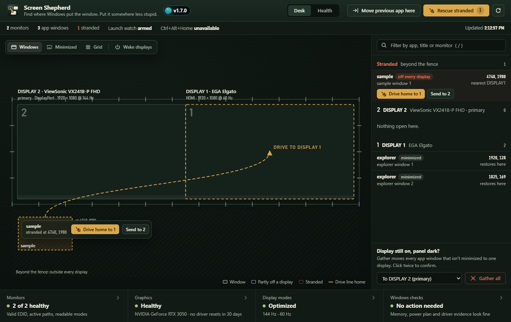
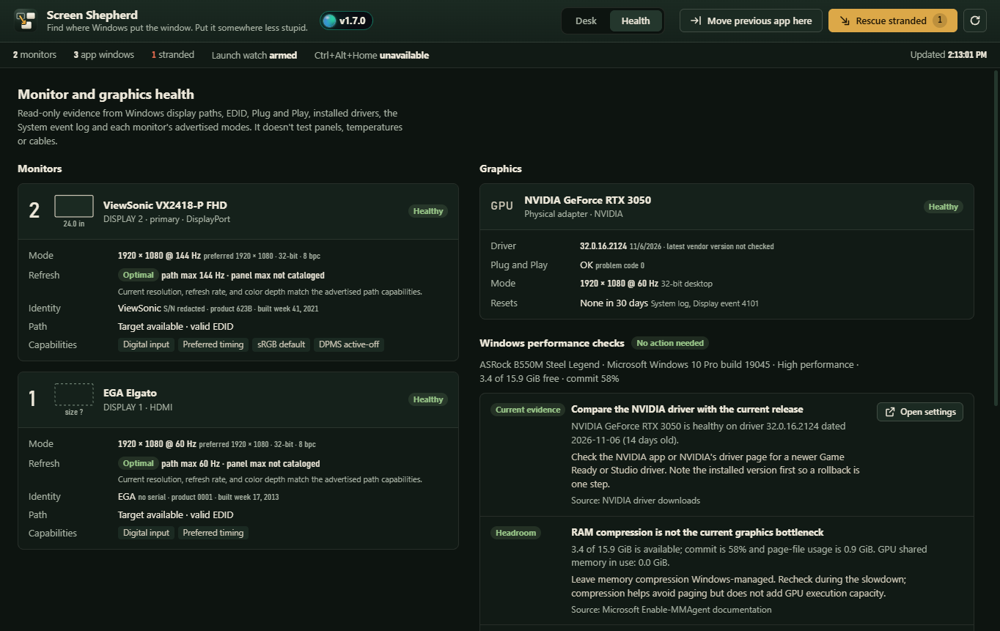
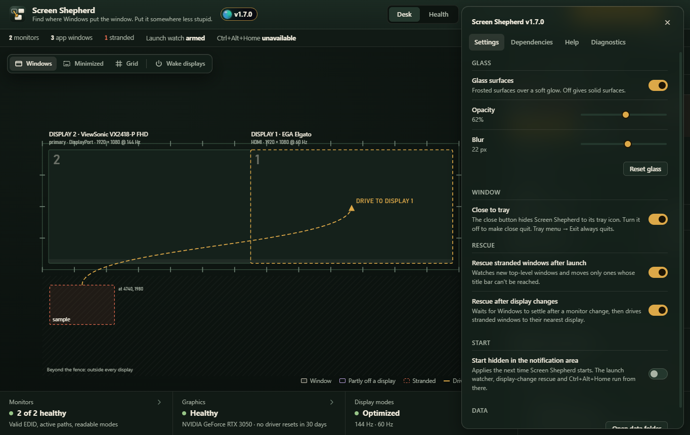
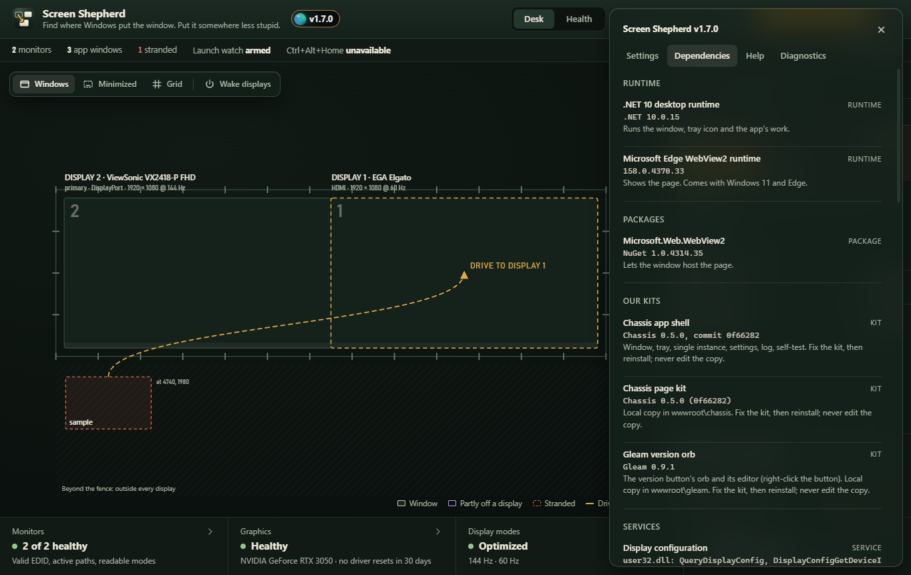

# Screen Shepherd

**See every window on a multi-monitor Windows desk, and bring back the ones stranded off-screen.**

[Download](https://github.com/mikedopp/ScreenShepherd/releases/latest) · [Report a bug](https://github.com/mikedopp/ScreenShepherd/issues/new?template=bug.yml) · [Request a feature](https://github.com/mikedopp/ScreenShepherd/issues/new?template=feature.yml)


<sub>The Desk view. Every monitor and window is drawn to scale; a window stranded off every display waits beyond the fence with a line to the nearest monitor.</sub>

## Summary

Unplug a monitor, undock a laptop or power off a screen, and Windows can leave apps on a display that is no longer there. Screen Shepherd is a small Windows tray app that shows where every app window really is, monitor by monitor, and moves the stranded ones back where you can reach them: by drag, by button, by hotkey, or on its own when the displays change.

It also reads each monitor's identity and connection, grades monitor and graphics-adapter health from what Windows reports, and lists read-only performance checks for the PC it runs on.

- **Local only.** No network connections, screenshots, window contents, keystrokes or credentials.
- **Changes nothing on its own** except window positions. Health and performance checks only read; settings pages open for you to decide.
- **Free and open source** under the MIT license.

## Requirements

- Windows 10 or 11, 64-bit.
- [.NET 10 Desktop Runtime](https://dotnet.microsoft.com/download/dotnet/10.0) (x64).
- [Microsoft Edge WebView2 Runtime](https://developer.microsoft.com/microsoft-edge/webview2/). Windows 11 and recent Windows 10 already have it.
- To build from source: the .NET 10 SDK.

## Quick start

Install the runtimes, if you don't have them:

```powershell
winget install Microsoft.DotNet.DesktopRuntime.10
winget install Microsoft.EdgeWebView2Runtime
```

Download `ScreenShepherd-<version>-win-x64.zip` from [Releases](https://github.com/mikedopp/ScreenShepherd/releases/latest), then unzip and run it:

```powershell
Expand-Archive .\ScreenShepherd-*-win-x64.zip -DestinationPath .\ScreenShepherd
.\ScreenShepherd\ScreenShepherd.exe
```

Each release lists SHA-256 sums; check yours with `Get-FileHash .\ScreenShepherd-*-win-x64.zip`. There is no installer: the folder is the app, and deleting it (plus `%LOCALAPPDATA%\Screen Shepherd\`) removes it.

## How to use

1. **Open it.** The window shows your desk: each monitor drawn to scale with its number, model and mode, every app window on it, and the same windows listed by display on the right. Screen Shepherd also sits in the notification area; closing the window keeps it running there.
2. **Spot the strays.** A window that is off every display is drawn *beyond the fence* with a line to the monitor nearest to it. Windows whose title bar you can't reach are flagged too. The top bar counts them.
3. **Bring one back.** Drag it on the map and drop it where it should land. Or click it, then **Send to** a display or **Center** it. Minimized and maximized windows keep their state.
4. **Bring them all back.** **Rescue stranded** moves every stranded window to its nearest display. By default this also happens on its own when an app opens off-screen or when the displays change; turn either off in Settings.
5. **From anywhere.** `Ctrl+Alt+Home` moves the window you're in to the monitor under the mouse.
6. **A monitor that is off but still "there".** Some screens keep reporting themselves as active over HDMI or DisplayPort when powered off. **Gather all windows** pulls everything onto the screens you can see.
7. **Check health.** The **Health** tab shows each monitor's identity, connection, current and best mode, the graphics adapter's state, and ranked read-only checks for this PC.
8. **Settings and help.** Click the version button next to the title for Settings, Dependencies, Help and Diagnostics.

Keyboard: `/` filters the window list, `F5` refreshes, `Esc` closes the panel or clears the selection.

## Screenshots

Captured from the real app with `ScreenShepherd.exe --snapshot <file.png> --query "redact=1&stray=1"`: live data from the build PC, with window titles, monitor serial numbers and profile paths replaced. The stray named "sample" is a made-up window added so the drive line shows.

| | |
|---|---|
| <br><sub>**Desk**: drag a window where you want it, or select it and Send to a display.</sub> | <br><sub>**Health**: each monitor's identity, path and mode, the graphics adapter, and read-only checks.</sub> |
| <br><sub>**Settings**: rescue behaviour, Close to tray, start hidden, and the glass look.</sub> | <br><sub>**Dependencies**: everything the app uses, and where it lives.</sub> |

## What It Does

- Shows the whole desk at once: every monitor and normal app window drawn to scale from real physical-pixel coordinates, with each display's run number, model, connection and mode, and windows grouped by display in a filterable list.
- Moves windows directly: drag one on the map and drop it where it should land (kept inside the work area, optionally snapped to a 120-pixel grid), or select it and Send to another display or Center it.
- Lists each window's process, title, coordinates, display and visible percentage. Visibility uses the frame Windows actually draws, so edge-snapped and maximized windows are not reported as partly off-screen.
- Reads monitor manufacturer, model, serial, manufacture date, physical size, active connection, current/preferred mode, color depth, and EDID capability flags.
- Grades each active monitor path as **Healthy** or **Review** using Windows path availability, EDID validity, identity, and current-mode evidence.
- Flags duplicate EDID identities when one physical display appears on multiple active Windows paths.
- Checks physical and virtual display adapters separately using Windows status, Plug and Play problem codes, installed driver metadata, and recovered display-driver resets from the last 30 days.
- Grades display-mode optimization against preferred resolution, the refresh rate exposed by the current Windows path, and known manufacturer limits for recognized monitor models.
- Distinguishes a monitor-path bottleneck from a cataloged host-platform ceiling, including the Surface Laptop 5 external-display limit.
- Ranks read-only Windows performance checks from live evidence: driver age (with advice for the actual GPU vendor or PC maker), memory headroom and commit charge, GPU shared memory, page-file usage, active power plan, Game DVR, hardware-scheduling override, and inactive virtual adapters.
- Opens allowlisted Windows Settings pages for review without changing drivers, registry values, power plans, or memory policy.
- Shows aggregate Chrome and Edge working-set/private memory plus browser-tab count when the visible tab strip is available through Windows UI Automation.
- Sends a normal Windows display wake signal without changing monitor inputs or stored display configuration.
- Puts windows that are off every display beyond the fence instead of on a monitor they don't occupy, with their true coordinates and a drive line to their nearest display.
- Flags a window when its title bar is unreachable on every active display.
- Rescues only stranded windows, each to its nearest display, after an application launches, after the display topology changes, or when you press **Rescue stranded**.
- Moves the foreground window to the monitor under the mouse with `Ctrl+Alt+Home`.
- Provides a guarded **Gather all windows** action for monitors that remain logically active after the physical panel is powered off.
- Preserves minimized/maximized state while moving a window: a minimized window stays minimized and restores onto the target; a maximized window ends up maximized on the target.

No screenshots, window contents, keystrokes, credentials, or remote endpoints are used.

## Tray, settings and options

- **Tray.** The notification-area menu starts with the running version, then Open, Hide, the rescue actions and Exit. Double-click the icon to reopen the window. Rescue results from the tray and the hotkey show as a Windows notification.
- **Close to tray** is on by default: closing the window keeps the launch watcher, display-change rescue and `Ctrl+Alt+Home` running. Turn it off (Settings in the version pop-out) to exit when the window closes. **Exit** always quits.
- **Single instance.** Launching it again brings the running window back instead of starting a second copy. `ScreenShepherd.exe --exit` asks a running copy to quit (exit code 1 if none is running). `--hidden` (or the older `--minimized`) starts it in the notification area.
- **Version pop-out.** The orb pill next to the title shows the version read from the build; its orb thinks while an action runs and flashes success or error when it ends. Click it for the pop-out: **Settings** (glass on/off, opacity, blur and Reset; Close to tray; rescue behaviour; start hidden; open the data folder), **Dependencies** (every runtime, kit, Windows part and file the app uses and where it lives; Screen Shepherd needs no credentials and no network, and says so there), **Help**, and **Diagnostics** (versions, paths, what each Windows part answered on the last read, the run log, Copy diagnostics, and a window and monitor report as JSON). Right-click the orb to restyle it.
- **Glass.** Floating panels (the pop-out, the map toolbar, the selection bar, notices) use frosted glass over the desk; the map, lists and tables stay solid. Glass switches to solid panels on its own when Windows transparency effects are off, a high-contrast theme is on, or forced colours are active.
- **Keyboard.** `/` filters the window list, `F5` refreshes, `Esc` closes the pop-out or clears the selection; `Ctrl+Alt+Home` works from anywhere.

Automatic launch rescue and display-change rescue are on by default; both can be turned off in Settings. Settings are stored in `%LOCALAPPDATA%\Screen Shepherd\settings.json`, the run log in `screen shepherd.log` beside it, and the WebView2 profile in the `webview` folder there.

The **Health** view shows each monitor's identity (maker, serial, product, build date), path, current and preferred mode, panel size and EDID capabilities. Its badge is evidence-based: active Windows path, available target, valid EDID identity, friendly model, and readable refresh rate.

The **Graphics** part of Health separates adapter health from display optimization. Driver health is local and evidence-based; the app deliberately does not call an installed driver “latest” without checking the hardware vendor.

`PATH LIMITED` means the current resolution and color depth are correct, but Windows exposes a lower maximum refresh rate than the identified panel’s published specification. This often points to dock, MST/daisy-chain, cable, port, OSD, or bandwidth constraints rather than a failing monitor.

`PLATFORM LIMITED` means the panel supports more than the current host officially exposes. For a Surface Laptop 5, Microsoft documents 60 Hz as the maximum external refresh rate. Screen Shepherd treats that as a host ceiling instead of prescribing cable or registry folklore.

The **Windows performance checks** section is intentionally conservative. RAM compression can reduce paging under memory pressure, but it cannot add GPU execution capacity. When Windows shows adequate memory headroom, Screen Shepherd says so instead of recommending a memory-policy change. Memory and commit come from the kernel (`GetPerformanceInfo`) and GPU memory from the PDH `GPU Adapter Memory` counters, so a damaged WMI performance-class registration does not produce false zeros.

**Browser load** reports memory per browser, not per tab. Individual Chromium tab memory is not attributed without a browser debugging bridge. If Edge hides or virtualizes its tab strip, the count is shown as unavailable rather than estimated from renderer processes.

## Build

Requires the .NET 10 SDK.

```powershell
.\build.cmd               # publish, smoke test, QA (self-test and off-screen captures), zip and SHA256 sums
.\build.cmd -LiveMove     # also run the live window-move test
.\build.cmd -Screenshots  # also refresh docs\screenshots\ (redacted, sample stray); add -Hide a,b to leave processes out
```

The version lives only in `VERSION`. `build.ps1` publishes a framework-dependent build to `dist\ScreenShepherd-<version>-win-x64\`, checks the payload (including the Chassis and Gleam kits and the icon), checks that the exe's ProductVersion matches, runs `--smoke` and `--qa` against the published exe, proves glass on the rendered app (left alone it renders glass unless Windows asks for solid panels; asked for solid it renders solid; both captures are kept in `reports\qa-<version>\`), then writes `dist\ScreenShepherd-<version>-win-x64.zip` and `dist\SHA256SUMS-<version>.txt`. Receipts and captures go to `reports\`, which is git-ignored because they record this PC's monitor serial numbers and window titles.

The smoke test (`ScreenShepherd.exe --smoke --receipt <file>`) checks the UI assets, the embedded icon, version, monitor identity, graphics telemetry and its cache, browser usage and window enumeration, and records how long each read took.

QA (`ScreenShepherd.exe --qa <dir>`) runs the self-test (`--selftest`: Chassis's shell checks plus the app's own), then takes a snapshot per look and pop-out tab, each in its own process with a throwaway data folder, and writes `qa.json`. A snapshot (`ScreenShepherd.exe --snapshot <file.png> [--solid] [--panel settings|deps|help|diag] [--width W --height H] [--query "..."]`) renders the real window far off-screen with live host state, saves it as a PNG with WebView2's `CapturePreview`, and writes `<file.png>.json` with what the page shows (version label, orb state, glass or solid panels, map and list contents). It needs no screen capture, runs beside a normal instance, has no tray, hotkey, window hooks or rescue, and refuses any command that would change something. `--query` options: `view=health`, `select=1` (a window selected), `stray=1` (a labelled made-up stranded window so the drive line shows), `redact=1` for images meant to be shared (window titles become `<process> window N`, monitor serials become `redacted`, profile and app paths become `%LOCALAPPDATA%`, `%USERPROFILE%` and `<app folder>`), and `hide=a,b` to also leave those processes' windows out. Review the images before committing them; process names stay visible.

The live move test (`ScreenShepherd.exe --integration-test --receipt <file>`) creates real windows and moves them with the app's own code: a normal window beyond the desktop, a minimized window whose restore position is off-desktop, a drop at an exact spot (as a drag on the map does), and (with two monitors) a window maximized on another monitor. The test windows are fully transparent, click-through and never activated, and the target is a monitor away from the mouse pointer.

## Deliverables

| File | Purpose |
| --- | --- |
| `src\` | C# host and Win32 window-control source. |
| `Chassis\` | The app shell kit's copy (window, tray, single instance, settings, log, self-test); it is installed from the Chassis kit and never edited here. |
| `wwwroot\` | Web UI assets, including `wwwroot\chassis\` (Chassis page kit: version pop-out and glass) and `wwwroot\gleam\` (Gleam version-orb kit with its MIT licenses and NOTICE). |
| `assets\icon\` | Icon masters (`screenshepherd.svg` for 32 px and up, `screenshepherd-small.svg` for 16-24 px) and `build-icon.ps1`, which rebuilds `ScreenShepherd.ico` and `wwwroot\icon.svg` (needs Edge and ffmpeg). |
| `DESIGN.md` | The visual system (Trial Field). |
| `VERSION` | The version, and the only place it is set. |
| `build.cmd` / `build.ps1` | Versioned release build into `dist\`. |
| `docs\screenshots\` | Redacted screenshots used in this README. |
| `LICENSE` | MIT license. |
| `THIRD-PARTY-NOTICES.md`, `licenses\` | Third-party components and their license texts; shipped in every release. |
| `CHANGELOG.md` | Release history. |
| `PRODUCT.md` | Users, purpose and design principles. |

## Boundaries

- If a powered-off monitor still advertises itself over HDMI or DisplayPort, Windows reports it as active. Use the guarded gather action.
- **Wake display signal** asks Windows to power attached display paths on. It cannot force a physical monitor to leave another computer’s selected input; that requires the panel’s input controls or validated DDC/CI support.
- **Healthy** does not diagnose panel electronics. Backlight, pixel, temperature, cable signal quality, and physical power are outside the Windows topology/EDID evidence used here.
- Advanced color means the active Windows path reports advanced-color support. It is not labeled HDR because Windows can distinguish SDR wide-color and HDR modes.
- GPU health does not replace a temperature or stress test. Screen Shepherd checks loaded/PnP state and recent recovered resets, not thermal stability or failing VRAM under load.
- Driver age is a review signal, not proof that a driver package is obsolete. On a Surface, the Surface app and Windows Update remain the first update path; elsewhere the GPU vendor's tool is suggested, with the current package kept for rollback.
- Inactive virtual display drivers are shown as optional test candidates only. Their presence is not labeled as the cause of poor performance.
- Windows may reject movement of higher-integrity/elevated windows unless Screen Shepherd runs at the same integrity level.
- Secure-desktop prompts, exclusive full-screen applications, shell surfaces, and custom window hosts can ignore normal placement requests.

## Legal

Screen Shepherd is copyright (c) 2026 mikedopp and released under the [MIT License](LICENSE).

Third-party components keep their own licenses: the Microsoft WebView2 SDK (Microsoft BSD-style), System.Management (MIT), and the Gleam version orb (MIT), which includes LerSent001's orb (MIT) and Pixel Point's Toolcraft UI (MIT). [THIRD-PARTY-NOTICES.md](THIRD-PARTY-NOTICES.md) lists each one and where its license text is; the texts in `licenses\` and `wwwroot\gleam\` ship in every release build.

Product and company names (Windows, Surface, Dell, ViewSonic, Elgato, NVIDIA, AMD, Intel, Chrome, Edge) belong to their owners and appear only to describe the hardware and software the app reads.
